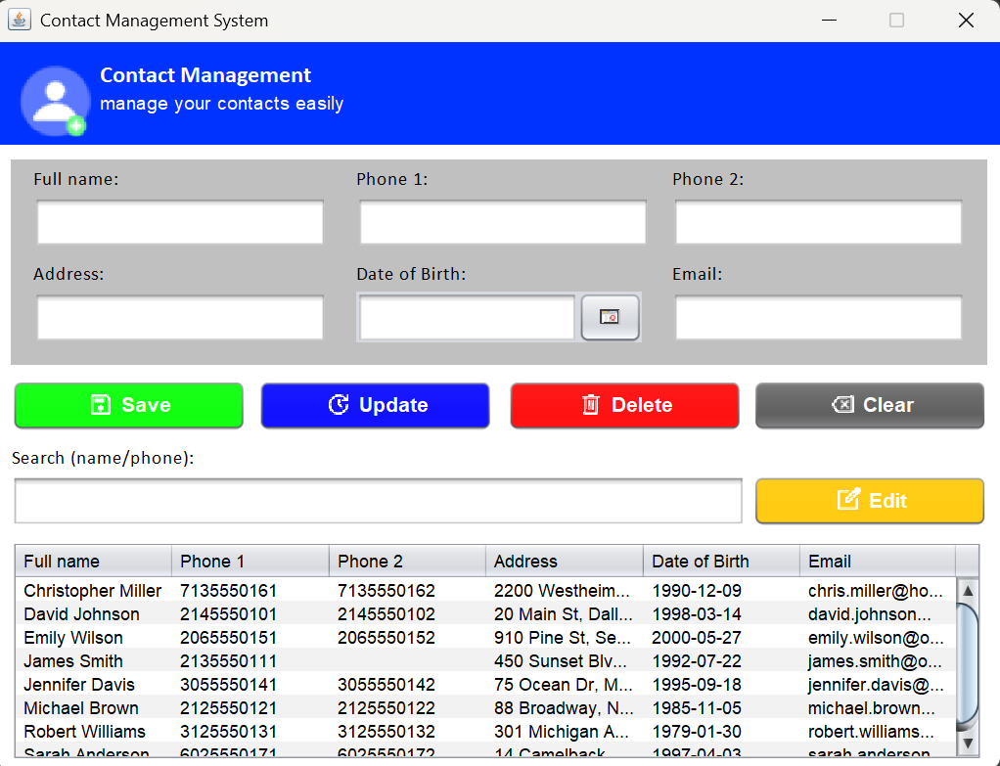

# Contact Management System

Desktop application built with Java Swing and MySQL to manage contacts: create, edit, delete and search.

### Main window



## Features

- Save, update and delete contacts
- Search by name or phone while typing
- Validation of emails (allowed providers only), phone numbers (digits only) and date of birth
- Duplicate detection by phone and email

## Tech stack

- Java
- Swing (Nimbus look and feel)
- JCalendar (`JDateChooser`)
- MySQL + JDBC (`mysql-connector-j`)
- MVC pattern with DAO

## Architecture (MVC)

The project follows the **Model-View-Controller** pattern, with a **DAO** layer to isolate database access. Each layer has one responsibility and only talks to the layers it needs.

| Layer | Package | Class | Responsibility |
|---|---|---|---|
| Model | `model` | `Contact` | Data of a contact (name, phones, address, date of birth, email). No logic. |
| View | `view` | `ContactView` | Swing window: form, buttons and table. It only displays and exposes components. |
| Controller | `controller` | `ContactController` | Handles button events, validates the form, and connects the view with the DAO. |
| DAO | `dao` | `ContactDAO` | All SQL queries (insert, update, delete, search). It knows nothing about the view. |
| Config | `config` | `DatabaseConnection` | JDBC connection to `contact_db`. |
| Util | `util` | `ContactValidator` | Validation rules for email, phones and date of birth. |

### How a request flows

```
User clicks "Save"
      │
      ▼
 ContactView  ──(button event)──▶  ContactController
                                        │  1. reads the form
                                        │  2. validates with ContactValidator
                                        │  3. builds a Contact (Model)
                                        ▼
                                    ContactDAO  ──▶  MySQL (contact_db)
                                        │
                                        ▼
 ContactView  ◀──(refresh table)──  ContactController
```

The view never touches the database, and the DAO never touches the view. The controller is the only class that knows both sides.

## Project structure

```
ContactManagement/
├── database/
│   ├── schema.sql
│
├── docs/
│   └── screenshots/
└── src/
    ├── Main.java
    ├── config/
    ├── controller/
    ├── dao/
    ├── model/
    ├── util/
    └── view/
```

## Setup

1. Run `database/schema.sql` in MySQL.
2. Set your MySQL password in `src/config/DatabaseConnection.java`.
3. Add `mysql-connector-j` and `jcalendar` to the project libraries.
4. Run `Main.java`.